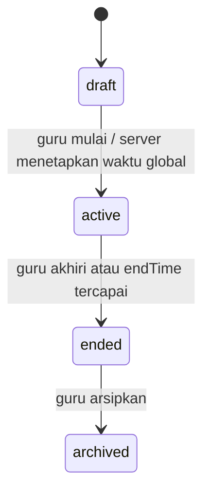
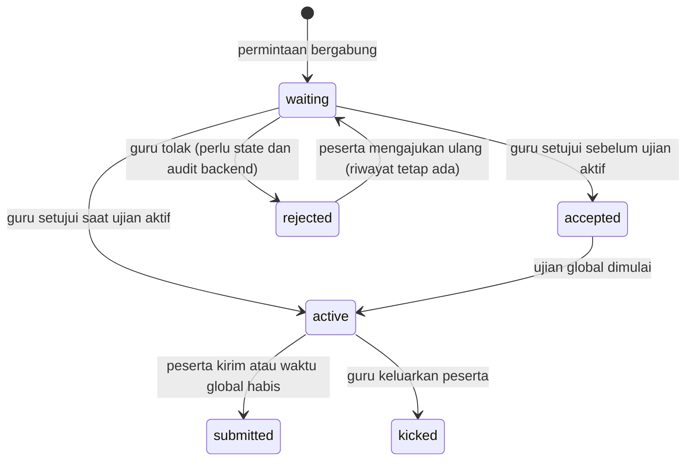

# Frontend Redesign Plan — EduQuas

> **Status:** Portal peserta dan pengerjaan dibangun ulang dengan Aurora; migrasi admission diterapkan dan alur utama telah diuji pada backend terkonfigurasi. Dashboard guru sedang dibangun; migrasi dashboard dan validasi terhadap database target belum dijalankan.  
> **Basis audit:** branch `main`, commit `5f9ec53`, working tree saat audit pada 2026-11-08.  
> **Cakupan dokumen:** temuan awal tetap merekam kondisi saat audit; bagian tindak lanjut di bawah merekam perubahan setelah persetujuan.

## Ringkasan

Bangun kembali pengalaman ujian dan dashboard di frontend `frontend/`. Untuk portal peserta yang baru, pengguna memilih palet Aurora asli dalam [Design System](DESIGN_SYSTEM.md). Prioritasnya adalah alur peserta yang jelas dan integrasi backend nyata; dashboard guru sedang dibangun berdasarkan DESIGN/Example.

Halaman ujian, monitor, waiting room, dan proctoring yang lebih lengkap telah dihapus dari working tree saat audit. Temuan tentangnya bersumber dari Git pada commit dasar dan merupakan referensi historis, bukan kemampuan frontend aktif. Backend yang dimodifikasi di working tree harus dibaca sebagai kondisi lokal saat audit; audit ini tidak menjalankan sistem.

Perubahan skema, kontrak API, izin, dan perilaku backend yang direkomendasikan di dokumen ini telah disetujui. Migrasi admission yang tersedia telah diterapkan dan diverifikasi pada database backend yang dipilih pengguna.

## Feature Gap Analysis

Tabel dan pemetaan API berikut merekam kondisi saat audit awal; status implementasi terkini dicatat pada bagian akhir dokumen.

| Area | Terverifikasi saat audit | Rencana / gap |
|---|---|---|
| Portal peserta | Halaman aktif menerima kode, identitas, dan status menunggu; menampilkan kesalahan kode/nama/NISN sebagai teks merah. | Pulihkan state peserta yang lengkap dan sambungkan ke runtime ujian aktif. |
| Dashboard | Navigasi Ringkasan, Ujian, Bank soal, dan Guru (khusus admin); ada form/dialog guru dan bank soal. | Tambah pembuatan/ubah ujian serta workspace monitor dalam navigasi Ujian. |
| Akses ujian | Kode akses enam karakter dibuat secara kriptografis, unik, tidak ambigu; validasi dan rate limit tersedia. Masa berlaku mengikuti status dan waktu ujian, tanpa TTL kode tersendiri. | Pertahankan mekanisme ini. Tampilkan kode secara jelas pada detail ujian dan monitor. |
| Admission | Endpoint menerima peserta waiting menjadi accepted. | Pada ujian aktif, persetujuan harus mengizinkan peserta masuk langsung memakai waktu global yang sama; perlu transisi backend atomik. |
| Penolakan | Belum ada status/riwayat penolakan tersendiri. `kick` mencabut token sesi. | Buat keputusan penolakan yang dapat diajukan ulang dan menyimpan riwayat; memerlukan persetujuan backend. |
| Waktu | Start global mengisi `startTime` dan `endTime`; scheduler mengakhiri ujian. | Pertahankan satu waktu global dari klik guru. Tidak ada timer individual atau timer yang berhenti saat lock/disconnect. |
| Monitor | Dashboard API mengembalikan agregat, halaman peserta, dan event terbaru. Socket.IO tersedia di backend. | Frontend aktif belum menghubungkan monitor atau Socket.IO; gunakan snapshot HTTP, socket, dan polling cadangan. |
| Pelanggaran | Kebijakan ambang configurable; lock dan pencatatan tersedia. | Tambahkan siklus pelanggaran setelah unlock yang terpisah dari total/riwayat; perbaiki deduplikasi dan relock. Persetujuan backend diperlukan. |
| Koneksi | Socket backend mencatat presence berbasis heartbeat, tetapi agregat `active` bukan bukti presence terbaru. | Labeli status koneksi hanya dari heartbeat/socket dengan freshness yang cukup; selain itu gunakan “Koneksi tidak diketahui”. |

## Examination Admission, Control & Live Monitoring

### Keputusan produk

| Perilaku | Ketentuan |
|---|---|
| Mulai ujian | Guru menekan satu kontrol mulai global. Server menetapkan `startTime`; `endTime = startTime + durationMinutes`. |
| Peserta terlambat | Mengikuti approval yang sama. Setelah disetujui, peserta langsung dapat masuk selama ujian aktif; memakai `endTime` global yang sama. |
| Penolakan | Peserta dapat mengajukan permintaan ulang. Riwayat keputusan tetap tersimpan. |
| Kunci biasa | Tiga pelanggaran sah dalam satu siklus memicu kunci sementara. |
| Setelah unlock | Siklus dihitung kembali dari nol. Total pelanggaran dan riwayat lama tetap disimpan; jawaban tidak berubah. |
| Screenshot shortcut | Tetap pengecualian yang langsung mengunci. Jelaskan batas deteksinya kepada peserta sebelum mulai. |
| Waktu | Waktu global terus berjalan saat peserta terkunci atau terputus. Unlock tidak memulai ulang durasi. |

### Lifecycle dan state peserta

Status koneksi (`connected`, `disconnected`, `unknown`) dan status lock (`normal`, `warning`, `locked`) adalah sumbu terpisah dari status keikutsertaan. Jangan mengganti status ujian peserta menjadi “offline” hanya karena ia locked. Nilai `active` dari REST adalah state ujian, bukan sinyal koneksi.

### Information Architecture

- Dashboard tetap satu area dengan navigasi Ringkasan, Ujian, Bank Soal, dan Guru sesuai peran.
- Detail dan monitoring ujian menjadi workspace pada bagian Ujian yang sama, bukan alur halaman yang memaksa guru keluar dari konteks.
- Workspace memiliki subbagian kontekstual: Ikhtisar, Peserta, dan Pelanggaran. Detail peserta terbuka di drawer; aksi singkat memakai dialog konfirmasi.
- Di sisi peserta, kode → identitas → menunggu approval → menunggu ujian / mengikuti ujian → selesai. Penolakan memberi alasan dan aksi ajukan ulang.

### Detailed UX Flows

**Sebelum ujian dimulai:** peserta memvalidasi kode dan mengirim permintaan; status waiting tampil dengan nama ujian dan status koneksi yang diketahui. Guru meninjau antrean, menyetujui atau menolak. Peserta accepted menunggu kontrol mulai global. Pada start, server mengaktifkan peserta accepted yang tidak terkunci dan mengirim waktu global.

**Ujian berjalan:** peserta terlambat mengikuti antrean approval. Approval saat ujian aktif harus secara atomik mengaktifkan peserta yang lolos dan mengembalikan waktu global yang ada. Peserta memuat sesi dan jawaban tersimpan; tidak memperoleh durasi baru. Jika ujian berakhir sebelum admission selesai, penolakan backend bersifat terminal untuk ujian tersebut.

**Pelanggaran dan unlock:** peringatan menyebut kejadian yang dihitung. Tiga kejadian sah dalam siklus mengunci sementara dan menghentikan input baru, tetapi tidak menghentikan jam global atau menghapus jawaban. Guru melihat riwayat lalu dapat unlock. Unlock mencatat siapa/kapan, mereset hitungan siklus saja, dan mempertahankan total historis. Shortcut screenshot tetap langsung mengunci tanpa menunggu ambang.

**Koneksi terputus:** tampilkan waktu sinkron terakhir dan status tidak terhubung. Saat reconnect, ambil ulang snapshot otoritatif melalui HTTP, pulihkan jawaban dan sisa waktu dari `endTime`, lalu sambungkan kembali event. Jangan menyimpulkan pelanggaran dari blur, visibilitas, atau kehilangan koneksi.

### Page Specifications

**Workspace monitor**

- Header: nama/status ujian, kode akses, waktu global tersisa yang bersumber dari `endTime` dan `serverTime`, aksi mulai/akhiri sesuai status dan izin.
- Ringkasan jumlah peserta sebagai baris informasi: permintaan menunggu, disetujui/aktif, selesai, terkunci. Angka berlabel; jangan membuat deretan kotak statistik dekoratif.
- Grid responsif berisi identitas, status keikutsertaan, koneksi (atau tidak diketahui), progres jawaban, jumlah pelanggaran, dan lock. Status selalu memakai teks atau ikon selain warna.
- Filter/pencarian harus menjaga urutan dan posisi item ketika update realtime masuk. Tampilkan skeleton, keadaan kosong, galat yang dapat dicoba ulang, dan status socket terputus.
- Drawer detail menampilkan hanya data yang berizin: identitas, status, koneksi dengan waktu terakhir, progres, total/catatan pelanggaran, lock, dan aksi guru yang relevan.
- Dialog konfirmasi untuk mulai/akhiri, tolak, keluarkan, dan unlock. Jelaskan efek dan risiko data sebelum konfirmasi. Drawer/dialog mendukung Escape, fokus terperangkap dan dikembalikan, serta layar penuh di ponsel.

**Sisi peserta**

- Bedakan “Menunggu persetujuan”, “Disetujui — menunggu guru memulai”, “Ujian berlangsung”, “Ditolak”, “Koneksi terputus”, “Terkunci sementara”, dan “Ujian selesai”.
- Sebelum mulai, jelaskan kebijakan pelanggaran dan pengecualian shortcut screenshot dengan batas teknis yang benar.
- Tampilkan jam dari waktu server. Ketika terkunci atau reconnect, jam tetap mengikuti `endTime` global.

### Component Architecture

Bangun dengan komponen terpisah untuk `ExamWorkspaceHeader`, `GlobalExamTimer`, `ParticipantSummary`, `ParticipantGrid`, `ParticipantRow/Card`, `ParticipantDetailDrawer`, `AdmissionQueue`, `ViolationHistory`, dan dialog aksi. Pisahkan hook snapshot HTTP, stream Socket.IO, freshness koneksi, serta model status UI agar event transport tidak menjadi sumber kebenaran tunggal.

Gunakan `StaffDialog` native yang aktif saat ini sebagai pola dialog dan aksesibilitas, setelah memverifikasi perilakunya pada drawer/modal ujian. Peserta tidak memakai komponen dashboard terproteksi.

### API Integration Mapping

| Kebutuhan | Endpoint/event yang telah diverifikasi | Catatan |
|---|---|---|
| Buat kode / ujian | `POST /api/exams` | Kode unik enam karakter dibuat server; cek collision dibatasi. Tidak ada TTL terpisah. |
| Daftar/akses ujian | `GET /api/exams`, `GET /api/exams/:id`, `PUT /api/exams/:id/status` | Transisi status validasi backend; start mengisi waktu global. Start saat ini belum memakai compare-and-set atomik. |
| Validasi kode | `POST /api/join/validate` | Uppercase, pembatasan percobaan, menolak ujian berakhir/expired. Validasi tidak berarti admission. |
| Permintaan join | `POST /api/join` | Peserta baru masuk `waiting`; unique exam/NISN; token sesi cookie httpOnly. Kicked/submitted tidak dapat join ulang. |
| Antrean dan lobby | `GET /api/exam-session/waiting`, `GET /api/exam-session/lobby` | Waiting dipoll saat ini; lobby mem-mask NISN peserta lain. Rejection/reapply butuh kontrak tambahan. |
| Snapshot guru | `GET /api/exams/:id/dashboard`, `GET /api/exams/:id/students?page=&pageSize=` | Dashboard memberi agregat dan event terbaru; daftar peserta maksimum 200 per halaman. `onlineCount` sekarang dihitung dari `status=active`, bukan presence terbaru. |
| Approval | `POST /api/exams/:id/students/:sid/accept`, `POST /api/exams/:id/students/accept-all` | Mengubah waiting ke accepted; pada ujian aktif masih perlu start terpisah. Rencana mengusulkan admission langsung yang aman dan atomik. |
| Start peserta | `POST /api/exams/:id/students/:sid/start` | Jika ujian draft, route ini dapat memulai seluruh ujian sebagai efek samping. Perlu hilangkan ambiguitas; aksi utama mulai harus global. |
| Sesi dan jawaban | `GET /api/exam-session`, `POST /api/exam-session/answer` | Session mengirim soal tanpa jawaban benar, memulihkan jawaban; answer menyimpan/upsert dan mengirim progress. |
| Heartbeat | `POST /api/exam-session/heartbeat` | Mengembalikan status lock/ujian dan server time. Reconcile status pada reconnect; socket heartbeat memakai snapshot student yang dapat usang. |
| Unlock / kick | `POST /api/exams/:id/students/:sid/unlock`, `POST /api/exams/:id/students/:sid/kick` | Unlock saat ini hanya menghapus `isLocked`; kick mencabut token. Penolakan bukan kick. Unlock perlu audit dan hitungan siklus persisten. |
| Peringatan / riwayat | `POST /api/exams/:id/students/:sid/warn`, `GET /api/exams/:id/students/:sid/violations` | Endpoint riwayat memberi semua event/warning tanpa pagination. Audit UI harus membatasi beban data sebelum skala besar. |
| Pelanggaran peserta | `POST /api/proctoring/event`, `POST /api/proctoring/events/batch` | Ada kebijakan ambang/aksi; screenshot shortcut langsung lock. Deduplikasi dan konsistensi batch/single belum memadai. |
| Realtime | Namespace `/teacher-dashboard`, `/student-session`; contoh event: `exam_started`, `exam_ended`, `student_joined_waiting`, `student_status_changed`, `student_answer_progress`, `student_presence`, `student_violation`, `student_unlocked` | Socket.IO ada di server; frontend aktif belum punya `socket.io-client`. Gunakan snapshot awal, resync saat reconnect, polling cadangan. REST admin lintas ujian dan izin room socket belum selaras. |

**Sumber route dan layanan untuk tabel:** `backend/src/lib/code-generator.ts`; `backend/src/app/api/exams/route.ts`, `backend/src/app/api/exams/[id]/route.ts`, `backend/src/app/api/exams/[id]/status/route.ts`, `backend/src/app/api/exams/[id]/dashboard/route.ts`, `backend/src/app/api/exams/[id]/students/route.ts`, `backend/src/app/api/exams/[id]/students/[sid]/{accept,start,unlock,kick,warn,violations}/route.ts`; `backend/src/app/api/exams/[id]/students/accept-all/route.ts`; `backend/src/app/api/join/{validate,route.ts}`; `backend/src/app/api/exam-session/{route,waiting/route,lobby/route,answer/route,heartbeat/route}.ts`; `backend/src/app/api/proctoring/{event/route.ts,events/batch/route.ts}`; `backend/server.ts`; `backend/src/lib/{scheduler,proctoring-events}.ts`; `backend/prisma/schema.prisma`.

### Audit deteksi dan penguncian

Detektor browser yang ada hanya tersedia dalam kode frontend lama di Git. Ia pernah mengirim `window_blur`/`tab_switch`, memblokir beberapa aksi copy/paste, dan mengirim metadata untuk shortcut screenshot tepercaya. Backend mengabaikan blur sebagai bukti screenshot dan tidak menganggap copy/paste sebagai pelanggaran. Deteksi screenshot dipicu hanya untuk metadata shortcut tertentu; event itu menunjukkan shortcut terdeteksi, bukan bahwa file tangkapan layar benar-benar dibuat. Deteksi devtools lama berbasis shortcut keyboard, bukan bukti inspeksi sistem yang andal.

[Page Visibility API](https://developer.mozilla.org/en-US/docs/Web/API/Page_Visibility_API) memberi informasi tentang visibility dokumen. [UI Events](https://www.w3.org/TR/uievents/) mendefinisikan input dan fokus UI. Blur dan perubahan visibilitas tidak membuktikan screenshot atau aktivitas OS; jangan menyatakan kemampuan tersebut ke peserta.

Backend menerima konfigurasi `max_violations` (default 3) dan aksi (default lock). Saat ini screenshot langsung lock tanpa memperhatikan aksi konfigurasi. Setelah unlock, total violation lama masih memenuhi ambang dan dapat menyebabkan event berikutnya yang tidak dihitung mengunci ulang. Penyimpanan/increment/lock terpisah dan belum ada deduplikasi incident ID; duplikat, replay, atau race dapat memengaruhi ambang. Lock tidak boleh menghapus jawaban.

### Technical Risks (risiko teknis dan keamanan)

- Persetujuan aktif + masuk langsung perlu transaksi/idempotensi agar tidak menciptakan dua state, sesi, atau waktu ujian.
- Start simultan dapat menimpa waktu global sebab transisi sekarang bukan compare-and-set atomik.
- Sinkronisasi socket dan REST memiliki celah hak akses admin; selaraskan pemeriksaan owner/admin sebelum memaparkan data.
- Event realtime dapat hilang, terduplikasi, atau datang tidak urut; resync HTTP dan deduplikasi diperlukan.
- Heartbeat socket memakai data student yang ditangkap saat koneksi, sehingga reconnect dapat menghidupkan status lama atau terminal. Revalidasi server diperlukan.
- Jangan menyebut status `active` sebagai online; gunakan heartbeat/socket dengan batas freshness eksplisit dan fallback “tidak diketahui”.
- Backend scheduler timer bersifat in-memory dan memulihkan ujian aktif saat boot; uji restart, beberapa instance, dan konkurensi sebelum mengandalkannya untuk skala produksi.
- Jangan simpan token auth di storage browser untuk kebutuhan socket. Gunakan kredensial sesi yang sudah ada dengan kebijakan token server yang aman.

### Implementation Roadmap

1. **Kontrak dan persetujuan backend:** putuskan persistence rejection/reapply, event incident ID, siklus pelanggaran, semantics status connection, atomic start/admission, dan RBAC socket. Semua perubahan backend memerlukan persetujuan sebelum implementasi.
2. **Model UI dan alur peserta:** definisikan state terpisah untuk admission, ujian, lock, koneksi; tampilkan state loading/error/expired/rejected secara eksplisit.
3. **Dashboard monitor snapshot:** bangun workspace, agregat, daftar/pencarian/paginasi, drawer detail, dan aksi dengan API yang ada; jangan menampilkan affordance yang belum didukung.
4. **Sinkronisasi realtime:** gunakan namespace/event yang ada, snapshot saat mount dan reconnect, polling fallback, freshness heartbeat, dedupe event.
5. **Integrasi backend yang disetujui:** atomic global start/admission, rejection history, audit unlock, cycle counter, incident idempotency, izin konsisten.
6. **Hardening dan kesiapan rilis:** aksesibilitas, responsif, beban, expiry, reconnect, scheduler, keamanan dan uji end-to-end.

### Testing Strategy

Audit ini berbasis pembacaan sumber, bukan pengujian runtime. Implementasi kelak perlu menguji:

- Approval sebelum mulai, rejection, reapply dengan histori, dan race approve/reject.
- Late admission memakai `endTime` yang sama; percobaan setelah ujian ended ditolak.
- Timer tidak berubah/berhenti pada lock, reconnect, atau offline; expiry global menyelesaikan semua peserta.
- Reconnect memulihkan jawaban dan status server; event socket hilang/duplikat/out-of-order diikuti resync.
- Tiga pelanggaran sah mengunci; event tak dihitung tidak mengunci ulang; unlock mereset siklus namun mempertahankan total, histori, dan jawaban.
- Screenshot shortcut langsung lock; blur/visibility saja tidak diklasifikasikan sebagai screenshot.
- Guru owner dan admin mendapat izin sesuai kebijakan yang sama via REST dan socket; guru lain ditolak.
- Koneksi stale/tidak diketahui tidak ditampilkan sebagai online; drawer/dialog bisa dinavigasi keyboard dan fokus kembali dengan benar.
- Keadaan loading, empty, API error, socket disconnected, mobile fullscreen, reduced motion, dan screen reader.

### Acceptance Criteria

- Peserta melihat state admission yang jelas dan guru dapat meninjau permintaan dari workspace ujian.
- Guru memiliki satu kontrol global mulai; server menetapkan satu pasang waktu global yang tidak bisa diperpanjang oleh admission terlambat atau unlock.
- Grid menunjukkan status, koneksi dengan freshness, progres, violation count, dan lock tanpa mengandalkan warna.
- Drawer menampilkan data yang tersedia dan diizinkan; aksi konfirmasi menjelaskan efeknya.
- Rejection/reapply, cycle counter, event deduplication, dan audit unlock hanya dianggap selesai setelah kontrak/persistence backend disetujui serta diverifikasi.
- Realtime pulih dari disconnect melalui snapshot HTTP; polling cadangan menjaga monitor tetap berguna.
- Tidak ada klaim screenshot OS yang tak didukung. Jawaban peserta bertahan saat lock/unlock/reconnect.
- Semua sumber runtime masih perlu diverifikasi terhadap environment target; dokumen ini tidak menyatakan build atau runtime lulus.

### Open Questions saat audit — tindak lanjut setelah persetujuan ada di bawah

1. Apakah skema boleh ditambah untuk rejection decision/history dan permintaan ulang yang mempertahankan identitas peserta?
2. Apa definisi satu **pelanggaran sah**: event source, window/dedup interval, dan korelasi batch dengan single event?
3. Apakah event harus membawa incident ID idempotent yang dibuat client atau server; bagaimana menangani replay dan timestamp client yang keliru?
4. Apakah `violationCycleCount` disimpan terpisah dari total historis, dan audit event unlock mencatat guru, waktu, serta alasan?
5. Kontrak atomik apa yang disepakati untuk start ujian dan admission saat active; bagaimana skala multi-instance menangani scheduler?
6. Apa batas freshness presence agar UI boleh memakai label online, serta fallback ketika socket/polling keduanya terputus?
7. Apakah admin diberi akses lintas ujian yang sama di room socket dan endpoint REST?
8. Bagaimana alasan penolakan disampaikan tanpa membocorkan informasi sensitif, dan berapa lama riwayatnya disimpan?

## Sumber dan batas audit

Sumber aktif yang diperiksa: `frontend/src/app/page.tsx`, `frontend/src/app/globals.css`, `frontend/src/app/(staff)/dashboard/page.tsx`, `frontend/src/app/(staff)/staff.css`, `frontend/src/lib/staff-auth.tsx`, `frontend/next.config.ts`, serta route dan schema terkait di `backend/src/app/api/{exams,join,exam-session,proctoring}` dan `backend/prisma/schema.prisma`. Perilaku monitor/proctoring lama diperiksa dari Git pada `frontend/src/app/exam/session/page.tsx` dan `frontend/src/lib/{examSession,screenshot-shortcuts}.ts` di commit dasar, bukan dari frontend aktif. Contoh motion React yang dibaca untuk pola implementasi ada di [`Example/src/main.jsx`](Example/src/main.jsx), [`Example/src/styles.css`](Example/src/styles.css), dan [`Example/MOTION_GUIDE.md`](Example/MOTION_GUIDE.md); contoh tersebut bukan kode produk dan dialognya perlu hardening fokus sebelum digunakan.

Working tree saat audit memiliki perubahan dan penghapusan lokal. Graph Engram dibangun dari `1897f06`, sedangkan HEAD adalah `5f9ec53`; hasil graph dipakai hanya sebagai petunjuk lokasi dan tidak dianggap sebagai bukti kondisi terbaru. Audit ini source-based dan tidak menjalankan UI, API, atau database.

Lihat [Design System](DESIGN_SYSTEM.md) dan [Motion Guide](MOTION_GUIDE.md).

## Tindak lanjut prototipe sebelumnya (historis)

Bagian ini mencatat prototipe sebelumnya pada working tree. Frontend kemudian dihapus dan dibangun ulang; dashboard dan editor yang disebut di bawah belum tersedia pada frontend baru.

Implementasi pada working tree menambahkan workspace monitoring di dashboard aktif, sesi peserta, status rejection/reapply beserta riwayat, admission langsung untuk ujian aktif, waktu global yang tidak berubah saat start bersamaan, hitungan siklus pelanggaran, event ID unik untuk deduplikasi, audit unlock, dan pemeriksaan izin admin pada room socket. Perubahan skema disertai file migrasi `backend/prisma/migrations/20261108_exam_admission_violation_cycles/migration.sql`; migrasi belum diterapkan ke database.

Perubahan IP yang terdeteksi oleh heartbeat maupun reconnect sekarang memakai hitungan siklus dan update bersyarat agar retry/race tidak menggandakan insiden. Frontend menampilkan koneksi sebagai “Terhubung” hanya bila ada sinyal socket yang berumur maksimal 35 detik; snapshot HTTP dimuat saat membuka dan reconnect, sementara polling 12 detik menjadi cadangan. Shortcut screenshot tetap mengunci setelah server mengonfirmasi; teks sebelum peserta masuk menjelaskan bahwa browser hanya melihat shortcut, bukan keberhasilan screenshot.

Sesi peserta menampilkan konten terstruktur, persamaan, gambar, progres, penyimpanan jawaban, timer global, dan status terkunci/terputus. Dashboard memakai dialog native untuk detail drawer dan konfirmasi aksi; draf bank soal tetap tersimpan lokal saat editor ditutup dan penghapusannya eksplisit.

**Validasi saat tindak lanjut:** lint dan pemeriksaan TypeScript frontend lulus; pemeriksaan TypeScript backend lulus setelah Prisma Client digenerate; `prisma validate` lulus. Build frontend dan backend lulus setelah frontend memakai TypeScript API Next.js (`experimental.useTypeScriptCli: false`). UI browser, skenario API terhadap database, dan aksesibilitas drawer pada perangkat belum diuji runtime; migrasi belum diterapkan.

## Implementasi portal Aurora saat ini

- Frontend baru menyediakan `/` untuk kode, identitas, persetujuan, riwayat dan review, serta `/exam/session` untuk pengerjaan. Soal dan review mendukung gambar, konten terstruktur, KaTeX, pilihan tunggal/jamak, dan isian singkat.
- Workspace pengerjaan menggunakan header ujian dan timer netral, progress bar berdasarkan soal terisi, dan navigator nomor di samping pada desktop atau dalam deretan horizontal pada layar lebih kecil. Penanda “Periksa lagi” disimpan per ujian dan siswa di browser yang sama, serta dihapus setelah pengumpulan berhasil. Pengumpulan tersedia di akhir soal dengan dua konfirmasi; halaman selesai menampilkan nilai dan review sesuai izin ujian.
- Endpoint jawaban memvalidasi pilihan terhadap ID/label soal yang tersimpan, termasuk label lebih dari satu karakter. Format jawaban tetap string yang dipisah koma; ID yang ambigu karena koma ditolak dengan pesan yang jelas.
- Migrasi `20261108_exam_admission_violation_cycles` diterapkan pada database backend yang dipilih dan status Prisma menunjukkan semua migrasi telah diterapkan.
- Uji browser memakai fixture sementara pada backend nyata mencakup approval/reapply, peserta terlambat, gambar privat dan unggahan lama, persamaan, semua jenis soal, reconnect, lock/unlock, deduplikasi insiden, submit, review, dan privasi browser. Fixture dibersihkan setelah uji. Tampilan awal diperiksa pada lebar 1440, 390, dan 320 piksel.
- Penyimpanan jawaban yang belum dikonfirmasi berada di memori halaman dan dicoba lagi setelah koneksi pulih; browser memberi peringatan saat halaman ditutup dengan perubahan yang belum tersimpan.
- Lint, pemeriksaan TypeScript dan build frontend/backend, validasi Prisma, serta pengujian unit pilihan jawaban lulus. Pemeriksaan tambahan pada layar 320 px memastikan persamaan panjang dapat digeser dan pagination riwayat berfungsi. Audit dependensi produksi frontend tidak menemukan kerentanan; audit backend melaporkan dua high dan empat moderate yang memerlukan tindak lanjut dependensi.
- Implementasi awal dashboard guru tersedia pada working tree. Scheduler backend masih perlu strategi koordinasi untuk beberapa instance. Engram tidak diperbarui sesuai arahan pengguna; graph kode sebelumnya masih tertinggal.

Lihat [Design System](DESIGN_SYSTEM.md) dan [Motion Guide](MOTION_GUIDE.md).

## Tindak lanjut dashboard guru — 2026-11-09

- Sidebar dibagi menjadi Ruang Kerja dan Pengelolaan. Pencarian mencakup menu dan ujian; notifikasi merupakan ringkasan permintaan peserta dan jawaban yang belum dinilai, diperbarui berkala. Profil membuka dialog akun dan perubahan nama. Pada akhir halaman, tarikan lanjutan membuka menu berikutnya; tautan juga tersedia untuk keyboard dan gerakan dinonaktifkan ketika dialog atau input aktif.

- Ringkasan dashboard menggunakan Redis opsional dengan TTL 10 detik dan kunci terpisah untuk guru dan admin; saat Redis tidak tersedia, ringkasan diambil dari PostgreSQL. Monitoring, jawaban, dan status kunci tidak memakai cache ini. Docker Compose menjalankan Redis pada jaringan internal; untuk `start.sh` lokal, jalankan Redis lokal dan isi `REDIS_URL` di `backend/.env` (misalnya `redis://127.0.0.1:6379`). Jika kosong, cache dinonaktifkan.

- Dashboard memiliki enam bagian, login guru, folder bersama, editor soal MathLive/Tiptap, draf, impor/ekspor XML, pembuatan ujian dari salinan bank, monitoring, hasil, dan manajemen guru. Impor XML divalidasi dan dipratinjau server sebelum disimpan; ekspor menyertakan media terkelola. Referensi gambar eksternal tidak diunduh server.
- Metadata akademik dan folder disiapkan dalam migrasi tambahan `20261109_dashboard_metadata`. Migrasi ini telah diterapkan pada database yang dikonfigurasi setelah persetujuan pengguna; status migrasi Prisma dan endpoint overview, mata pelajaran, serta daftar ujian diperiksa setelah penerapan.
- Sesi peserta mencatat kehilangan fokus, shortcut devtools, dan keluar fullscreen sesuai pilihan kebijakan. Kehilangan fokus tidak membuktikan screenshot. Event yang belum terkirim disimpan di browser dengan ID insiden yang sama untuk dicoba kembali; jika penyimpanan browser gagal, antrean hanya bertahan di memori halaman.
- Ringkasan, pencarian, daftar peserta, dan rekap menggunakan filter dan pagination server. CSV hasil dibuat server sesuai filter. Migrasi dashboard diuji pada PostgreSQL sementara; pengujian integrasi mencakup izin, snapshot bank, start bersamaan, approval, pelanggaran, unlock, dan XML.
- Uji browser dengan API simulasi memeriksa navigasi, dialog dan lebar halaman pada 320, 390, 768, 1024 dan 1440 px; editor dan XML diuji dengan data simulasi. Uji tersebut tidak membuktikan integrasi database atau seluruh alur aksesibilitas.
- Uji browser tambahan memakai backend produksi dan PostgreSQL sementara mencakup admission, pengajuan ulang, gambar lama dan privat, persamaan, semua jenis jawaban, reconnect, lock/unlock, pengumpulan, serta review. Gambar lama dilayani melalui route runtime agar unggahan setelah build tetap terbaca.

**Status: Migrasi dashboard diterapkan; endpoint ringkasan, mata pelajaran, dan ujian terverifikasi pada database target. Pengujian browser dengan sesi pengguna pada lingkungan target masih diperlukan.**
